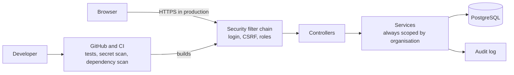

# Threat model

This document looks at the POPIA Toolkit the way an attacker would, using the STRIDE method (Spoofing, Tampering, Repudiation, Information disclosure, Denial of service, Elevation of privilege). It describes what exists today, where the gaps are, and what the penetration test should try. It is a first version, written before testing, and will be revised once the findings are in.

## 1. Scope

**In scope:** the web application, its PostgreSQL database, and the build pipeline on GitHub.

**Out of scope:** hosting, network setup, users' own devices and browsers. There is no production deployment yet, so the notes about HTTPS and the database are about what a deployment must do.

## 2. What we protect

| Asset | Why it matters |
|---|---|
| Separation between organisations | One business must never see or change another's records. This is the most important property. |
| Inventory records | They describe what personal information a business holds and where. They do not contain the personal information itself, which limits the damage if they leak. |
| Passwords and sessions | Stolen credentials give an attacker everything a user can do. |
| Audit log | Its value is that people can trust it. |
| Source code and pipeline | A compromise here reaches every future version. |

## 3. Who might attack

- An anonymous visitor on the internet
- A logged-in staff member trying to do admin things
- An admin of a different organisation trying to reach someone else's data
- Someone with a stolen password or session
- A malicious or vulnerable dependency, or a secret leaked into the code

## 4. How data flows

Trust boundaries: browser to application, application to database, developer to GitHub.

## 5. Threats by area

Each table lists the threat, what the project already does about it, what is missing, and how the penetration test will check it.

### Registration and login

| STRIDE | Threat | In place today | Gap | Test in the pentest |
|---|---|---|---|---|
| Spoofing | Guessing or reusing passwords | BCrypt hashing with salt, 12 to 72 character passwords, five failed logins per username in 15 minutes blocks further attempts | The limit is per username and held in memory, so it resets on restart, and it lets someone lock a known victim out for 15 minutes | Run many login attempts and confirm the block starts after five, looks identical to a normal failure, and lifts after the window |
| Information disclosure | Finding out which emails have accounts | Login returns the same result for a wrong password and an unknown email | Registration shows a generic failure for a duplicate email, but it is still distinguishable from other errors, and timing may differ | Compare responses and timings for new and existing emails |
| Denial of service | Mass registration creating many organisations | Input validation | No rate limit, no email verification | Script bulk registrations |
| Spoofing | Weak passwords | Minimum length of 12 | No check against known breached passwords | Try common long passwords |

### Sessions and the browser

| STRIDE | Threat | In place today | Gap | Test in the pentest |
|---|---|---|---|---|
| Spoofing | Stealing a session cookie | HttpOnly, SameSite lax, 30 minute idle timeout, Secure flag in the production profile | Secure is off for local development, no re-login for sensitive actions | Inspect cookies in DevTools and try to read them from a script |
| Spoofing | Session fixation | Spring Security issues a new session id on login | Not yet tested | Compare the session id before and after login in Burp |
| Tampering | Cross-site request forgery | CSRF tokens on every form, tests for a missing token | None known | Replay posts without a token and with another user's token |
| Tampering | Cross-site scripting | Output escaped by the template engine, content security policy limits scripts to this site | Stored payloads in item names and audit details not yet tried | Save script payloads in inventory fields and view them in the list, the edit form and the audit log |

### Staff management

| STRIDE | Threat | In place today | Gap | Test in the pentest |
|---|---|---|---|---|
| Elevation of privilege | Staff reaching admin pages | `/admin/**` requires the ADMIN role, tests for staff getting 403 | None known | Browse to admin URLs directly as staff |
| Elevation of privilege | Adding a role or organisation field to a form post | Forms have no such fields, role is fixed to STAFF, organisation comes from the login | None known | Add extra parameters in Burp and see if they are ever used |
| Spoofing | Admin knows a staff member's initial password | Every user can change their own password after confirming the current one, the change is audited | Existing sessions of that user stay valid after a change, and a stolen session can be used to guess the current password through this form without a limit | Change a password in one browser and check whether a second session still works, then try repeated wrong current passwords |
| Denial of service | Removing a compromised account | A disabled flag exists in the database | No screen to disable or remove staff | Review as a missing control |

### Inventory and organisation isolation

| STRIDE | Threat | In place today | Gap | Test in the pentest |
|---|---|---|---|---|
| Information disclosure | Reading another organisation's record by guessing its id | Every lookup includes the organisation, ids are random UUIDs, tests cover cross-organisation reads | None known | With two organisations, swap record ids in Burp for read, edit and delete |
| Information disclosure | Telling "exists elsewhere" from "does not exist" | Both give the same 404 | None known | Compare responses for a foreign id and a random id |
| Tampering | Changing or deleting another organisation's record | Same scoping, tests included | None known | Send edit and delete posts with a foreign id |
| Elevation of privilege | Staff deleting records | Delete requires ADMIN on the server | None known | Post to the delete address as staff |
| Tampering | SQL injection | Queries are parameterized through the data layer | Not yet tested | Run sqlmap against every parameter |
| Denial of service | Huge inputs and long lists | Length limits on every field | No pagination, no request size limit | Submit very large values and create many items |

### Audit log

| STRIDE | Threat | In place today | Gap | Test in the pentest |
|---|---|---|---|---|
| Repudiation | A user denies an action | Logins, failed logins for known accounts, staff creation and inventory changes are recorded | Failed logins for unknown emails are not recorded, reading data is not recorded | Perform actions and check the log is complete |
| Tampering | Changing past events | Events cannot be edited or deleted through the application | The database itself does not prevent it for someone with database access | Review as a design limit |
| Information disclosure | Staff or another organisation reading the log | Admin only, scoped to the organisation, tests included | None known | Request the audit page as staff and as another organisation's admin |
| Tampering | Injecting text into the log | Details are shown through escaped output | Item names flow into log details | Save line breaks and markup in item names and review the log page |

### Database and configuration

| STRIDE | Threat | In place today | Gap | Test in the pentest |
|---|---|---|---|---|
| Information disclosure | Leaked credentials | Settings come from environment variables, `.env` is not committed, secret scanning is on | Credentials sit in a local file on developer machines | Run a secret scan over the full history |
| Information disclosure | Database reachable from outside | Bound to localhost in development | A real deployment needs its own network rules | Check the exposed ports |
| Information disclosure | Detailed error pages | Stack traces and messages are turned off | None known | Trigger errors with bad input and read the responses |
| Elevation of privilege | Admin consoles | H2 console removed, only the health endpoint is exposed | None known | Request `/h2-console` and other `/actuator` paths |

### Pipeline and dependencies

| STRIDE | Threat | In place today | Gap | Test in the pentest |
|---|---|---|---|---|
| Tampering | Vulnerable or malicious dependency | Dependabot updates, weekly vulnerability scan | Indirect dependencies and tag-pinned actions carry some risk | Review the scan results and the lock of versions |
| Information disclosure | A secret committed to the repository | Push protection and a secret scan in CI | None known | Review scan results |
| Tampering | Compromised pipeline | The workflow token has read access only | Third-party actions are pinned by version tag rather than commit | Review workflow permissions |

## 6. Known gaps, in priority order

1. No way for staff to change a password, and admins set initial passwords
2. Changing a password does not end the user's other sessions, and the change form has no attempt limit
3. Registration is open to anyone, with no email verification or rate limit
4. Registration failures are still partly distinguishable
5. Failed logins for unknown emails are not recorded
6. No pagination on the inventory list
7. The audit log lives in the same database as everything else
8. The Secure cookie flag depends on running with the production profile
9. Login rate limiting is per username and in memory, so it resets on restart and can be used to lock a known account out temporarily

## 7. Assumptions

- A real deployment sits behind HTTPS and runs with the production profile.
- The database is not reachable from the internet.
- The application stores descriptions of personal information, not the information itself.
